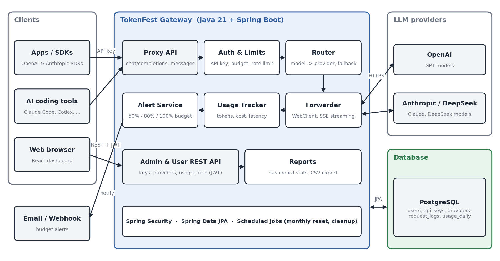

# Architecture

TokenFest has three parts:

- **Gateway (backend):** Java 21 + Spring Boot 4 (WebFlux), in `backend/`
- **Dashboard (frontend):** React + TypeScript + Tailwind CSS (Vite), in `frontend/`
- **Database:** PostgreSQL, started with `docker-compose.yml`

## Request flow

1. An app or AI tool sends an OpenAI-format or Anthropic-format request to the gateway with its own TokenFest API key.
2. **Auth & Limits** checks the key, the monthly budget, and the rate limit.
3. **Router** finds the providers that serve the requested model, in priority order.
4. **Forwarder** sends the request with WebClient and streams the response back. If the provider fails, it tries the next one.
5. **Usage Tracker** saves tokens, cost, and latency. **Alert Service** sends an email or webhook alert when a budget threshold is crossed.

The dashboard talks to the gateway through the REST API under `/api`. In development, Vite forwards `/api` to `http://localhost:8080`.

## Backend packages

| Package | Contents |
|---|---|
| `proxy` | Proxy endpoints, router, upstream client, SSE processing, fallback |
| `keys` | API key management and key check (cached) |
| `provider` | Provider management and the cached provider catalog |
| `limits` | Monthly budget (spending kept in memory) and rate limit (Bucket4j) |
| `usage` | Cost calculation and the background writer for request logs and daily totals |
| `alerts` | Budget threshold alerts by webhook and email |
| `stats` | Dashboard numbers and the request log |
| `export` | CSV export |
| `user` | API for team members (own data only) |
| `auth` | JWT login, security filter chains, first admin, login throttling, password change |
| `settings` | Settings stored in the database (alert settings) |
| `maintenance` | Nightly cleanup of old request logs |
| `crypto` | AES-GCM encryption of provider keys, derived signing key |
| `config` | App settings, WebClient, virtual threads for blocking controllers |
| `domain` / `repository` | JPA entities and repositories |
| `web` | Shared error handling, info endpoint |

## Deployment

`docker-compose.yml` runs PostgreSQL, the backend, and nginx (which serves the dashboard and forwards `/api` and `/v1`). See [deployment.md](deployment.md).

**Caching:** keys and providers are cached for 30 seconds (cleared on every change), and each key's monthly spending is kept in memory, so a proxied request normally needs no database call before it is forwarded.

**Threads:** the proxy is fully reactive (WebFlux + WebClient). Database calls from the proxy go through `Blocking.call(...)`. Admin controllers are normal blocking code; they run on virtual threads (see `AppConfig`), so they never block the Netty event loop.
